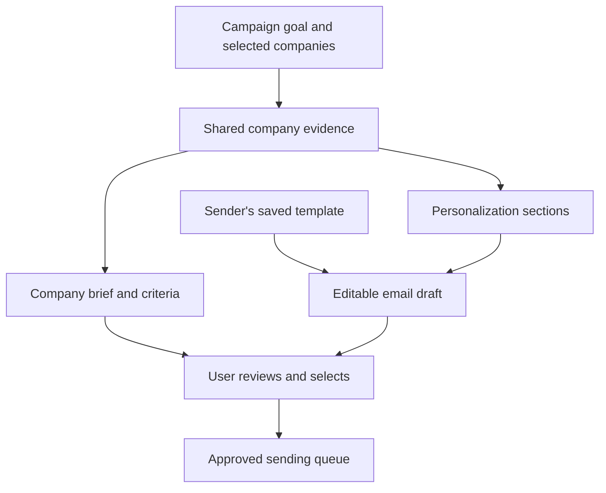

# Envoy

**Relevant companies. A reason to reach out.**

Envoy combines company discovery, research, professional contact lookup and personalized email drafting in one reviewed workflow. It helps consultants, freelancers, agencies and small business teams pursue clients and business partnerships while keeping control over their recipients and messages.

Built by **Adam Tang and Jiwoo Jung** for the UC Berkeley Innovation Intelligence Hackathon.

## Project thesis

Envoy brings company discovery, research and personalized outreach into one workflow for consultants, agencies and small business teams. Built by Adam Tang and Jiwoo Jung, it grew from Adam’s consulting-club experience: preparing outreach to one company took over an hour across Apollo, spreadsheets, Claude and GMass. Our thesis is that sharing context between research and email drafting can reduce preparation time while preserving relevance and the sender’s voice. Envoy supports client prospecting and business partnerships through three stages: set criteria, review research and send selected emails. Profiles provide source links, visible information gaps and criteria marked **Supported**, **Not met** or **Unknown**. Drafts combine company-specific personalization with the sender’s existing template, and users review recipients and messages before approving sending. Our proposed business model pairs an ad-supported free plan for individuals with a **$29/month Business subscription**. Next, we will evaluate time saved, draft quality, cost per usable contact and willingness to pay with small teams conducting real outreach.

## Pitch / demo video

**Video link: to be added before submission.** Add the publicly accessible 2–3 minute recording here and test it while signed out.

<!-- Replace the line above with a Markdown link to your actual uploaded recording. -->

## For judges

- Read the [project thesis](#project-thesis) for the problem and product insight.
- Follow the [quick start](#quick-start) to explore the built-in demo without provider keys or Google sign-in.
- Read [demo and live integrations](#demo-and-live-integrations) to distinguish sample behavior from configured external services.
- See the [technical handoff](docs/HANDOFF.md) and [application README](envoy/README.md) for implementation and testing instructions.

## Two campaign modes

| Mode | Goal | Example |
|---|---|---|
| Client prospecting | Find companies and relevant decision-makers for a product or service. | A consulting club looking for clean-energy companies it can support. |
| Business partnerships | Find companies with complementary capabilities for a collaboration. | A business seeking partners for a joint offering or distribution relationship. |

Both modes reuse the same discovery, research, contact and drafting pipeline. The campaign goal, targeting and message change with the selected mode.

## How it works

1. **Set criteria.** Save the sender’s profile and template, choose a mode, describe the goal, and add optional targeting criteria. Review the suggested organizations and select companies for research.
2. **Review research.** Examine the company brief, criteria, sources and available professional contacts alongside an editable email draft. Personalization changes the opening and project ideas while retaining the sender’s introduction, offer, request and signature.
3. **Send selected.** Review recipients and messages, approve the selected emails, and submit them through the configured Gmail account. In the built-in demo, this step records messages in a simulated outbox.

## Key features

- Company discovery and briefs organized around the campaign goal.
- Source links, criterion statuses and visible missing information.
- Professional contacts with source and status information when available.
- Sender templates with company-specific personalization and editable drafts.
- Recipient selection, duplicate prevention and previous-contact exclusions.
- Reviewed sending, configurable limits, opt-out handling and basic message history.

## Quick start

Prerequisites: Git, npm and **Node.js 20.9 or newer**, compatible with the repository’s Next.js 16 application. See the [Next.js system requirements](https://nextjs.org/docs/app/getting-started/installation#system-requirements).

```bash
git clone https://github.com/antangled/Envoy.git
cd Envoy/envoy
npm install
npm run dev
```

Open [http://localhost:3000](http://localhost:3000) and click **Try the demo**. In Setup, choose **Use the BEACN sample**, complete any required sender fields and save. Create a campaign, select organizations, review a brief and draft, then inspect the demo outbox.

The local development database is created automatically. Keep one development server running per database directory.

## Demo and live integrations

| Built-in demo | Configured live workflow |
|---|---|
| Uses fictional companies, sample source pages, contacts and scripted drafts. | Uses configured research and contact services, accessible company pages and AI-generated drafts. |
| Requires no external provider keys or Google sign-in. | Requires the relevant server credentials and Google OAuth configuration. |
| Records selected messages in a simulated outbox; no email is delivered. | Submits approved messages through the connected Gmail account. |

The built-in **Try the demo** account does not call the external research, contact or Gmail services. The application also has keyless fallbacks for individual pipeline stages; these are distinct from the scripted demo account.

### Enable integrations

From the `envoy/` directory, copy `.env.example` to `.env.local`, fill in the selected credentials, and restart the development server.

```bash
cp .env.example .env.local
```

| Variable | Purpose in the current repository |
|---|---|
| `ANTHROPIC_API_KEY` | Claude-based research and personalization. |
| `EXA_API_KEY` | Company and professional discovery, plus evidence search. |
| `HUNTER_API_KEY` | Current professional contact lookup integration. |
| `GOOGLE_CLIENT_ID` and `GOOGLE_CLIENT_SECRET` | Google account connection and Gmail authorization. |
| `APP_URL` | Application origin, such as `http://localhost:3000`. |

Keep credentials server-side and out of commits. For Google OAuth setup and production configuration, use the [handoff](docs/HANDOFF.md) and [application README](envoy/README.md).

**Contact-provider roadmap:** the current submitted contact pipeline still uses Hunter and company-published addresses. Anymail Finder is the planned replacement; that migration must be integrated and verified before being described as part of the submitted implementation.

## Technology behind Envoy

Envoy is a full-stack **Next.js, React and TypeScript** application. Its main technical idea is to reuse the same structured company research for the profile and the personalized email, while keeping sender-authored content and sending approval under the user's control.

| Layer | Current implementation |
|---|---|
| Interface and API | Next.js App Router, React and TypeScript; campaign API routes coordinate discovery, research, review and queueing. |
| Styling | Tailwind CSS. |
| Discovery | Exa searches for companies and relevant professional roles using the campaign goal and targeting criteria. |
| Evidence collection | Accessible company pages are fetched and cleaned with Mozilla Readability; Exa supplies additional searchable evidence. Each retained document receives a source reference. |
| AI research | Anthropic Claude produces a structured company brief, criterion assessments and personalization sections. Haiku is the primary model; selected validation failures can trigger a Sonnet retry. |
| Validation | JSON schemas and Zod constrain the output shape. Additional checks validate source IDs and quoted text; a model verifier reviews selected criteria and benefit claims. |
| Email assembly | A template renderer combines sender details, contact/company fields and the research-derived opening and optional ideas. Users can edit the final draft before approving it. |
| Contact lookup | The current code combines Hunter with professional contact details published by companies. Anymail Finder is a planned replacement, not yet the submitted integration. |
| Sending and history | Google OAuth and the Gmail API submit user-approved messages through a sending queue; the app stores submission status and failures. |
| Data and credentials | Drizzle ORM with local PGlite and a Postgres production configuration. Provider credentials stay server-side; Gmail refresh tokens are encrypted with AES-256-GCM. |

### From a goal to a reviewed message

1. **Discover candidates.** The campaign goal becomes targeting criteria and role suggestions. The user selects organizations for research.
2. **Build shared research.** The pipeline gathers a bounded set of company pages and evidence, then generates a brief and personalization sections together.
3. **Validate and assemble.** Source and quote checks help identify malformed or unsupported output. The template renderer preserves the sender's ordinary template text and inserts the personalized sections.
4. **Review and approve.** Users inspect sources, contact information and the editable draft before selecting recipients and approving queueing.
5. **Submit and record.** The configured live workflow submits approved messages through Gmail; the sample demo records them in a simulated outbox.



The research and drafting stages share context, so the email opening can refer to the same company information shown in the profile. The two campaign modes reuse this architecture with different goals and sender templates.

**Evidence checks have limits.** Source-reference validation establishes traceability; a valid reference or matching quote does not prove that every related claim is supported. The model verifier covers selected claims and is not a guarantee of correctness. Users should review source context and inferred opportunities before sending.

**Permission and demo boundaries.** Gmail access uses send-only permission; it does not enable inbox, reply or bounce monitoring. The built-in demo uses scripted research and drafts rather than external AI calls. Advertising, subscriptions and credit enforcement remain proposed commercial features.

Implementation: [pipeline](envoy/src/lib/pipeline/), [AI schemas and validation](envoy/src/lib/llm/), [template renderer](envoy/src/lib/template/), [provider integrations](envoy/src/lib/providers/) and [database](envoy/src/db/).

## Verification

Run these checks from `envoy/`:

```bash
npx tsc --noEmit
npm run lint
npm run build
```

The repository also contains `scripts/smoke.mjs` for campaign API checks and `scripts/mock-apis.mjs` for local provider stand-ins. Follow the [mock configuration instructions](envoy/README.md#verify) before running the smoke test: its pipeline checks require `ENVOY_DEMO_LIVE=1`, rather than the default scripted demo account.

Mock checks exercise application behavior without establishing the quality of real research, contact coverage or email delivery. A live campaign and test-inbox run remain separate validation steps.

## Proposed business model

| | Free | Business |
|---|---|---|
| Proposed monthly price | $0 | $29 |
| Primary audience | Individuals exploring occasional outreach. | Businesses, freelancers and recurring outreach users. |
| Advertising | Ad-supported within Envoy. | Ad-free. |
| Research allowance | Limited monthly credits; final allowance to be validated. | Proposed launch allowance of 200+ monthly research credits. |

One credit represents a completed company profile plus a personalized draft. It does not guarantee an available email address, delivery or a response. Prices, allowances, advertising and billing are commercial proposals for validation.

## Validation and next steps

The founder example motivates the product; it is not a measured before-and-after performance result. Our next validation work is to conduct 3–5 user interviews and recruit two named testers for comparable research-and-drafting tasks.

We will measure:

- Total campaign completion time, including review and edits.
- Reviewer agreement with matches and the source support for company facts.
- Draft corrections needed before a user would send a message.
- Total operating cost per suitable contact with a usable address, including unsuccessful attempts and retries.
- Repeat-use interest and willingness to pay.

Immediate engineering priorities include the contact-provider migration, configured live-integration checks and production readiness.

## Planned expansion

The MVP focuses on **Client Prospecting** and **Business Partnerships**. Future options remain outside the current demo scope:

| Area | Potential additions |
|---|---|
| Paid Business options | Sales workflows and higher research limits; Executive company briefs; Teams or Agency seats and shared templates. |
| Outreach modes | Recruiting, investor outreach, supplier sourcing and media outreach. |
| Integrations and automation | CRM integration and follow-up workflows after demand and outreach quality are validated. |

Future pricing and allowances are to be determined from user feedback and measured operating costs.

## Current limitations

- Accessible sources and contact availability vary; some results will contain unknown information or no usable address.
- Company relevance is not evidence of buying intent. Inferred needs and potential partnership benefits require review.
- Contact status labels are pipeline classifications, not guarantees of deliverability.
- Gmail submission success does not establish delivery, inbox placement or a reply. Send-only access does not provide automatic inbox, reply or bounce monitoring.
- The prototype and commercial plans require further live testing and customer validation before broad release.

## Documentation

- [Application setup and verification](envoy/README.md)
- [Technical handoff](docs/HANDOFF.md)
- [MVP build plan](docs/MVP-PLAN.md)
- [Next steps](docs/NEXT-STEPS.md)
- [Team brief](docs/INFO-SHEET.md)
- [Research and references](docs/research/)

## Team

**Adam Tang and Jiwoo Jung** — co-creators of Envoy. Adam’s consulting-club outreach experience provided the initial problem and use case.
